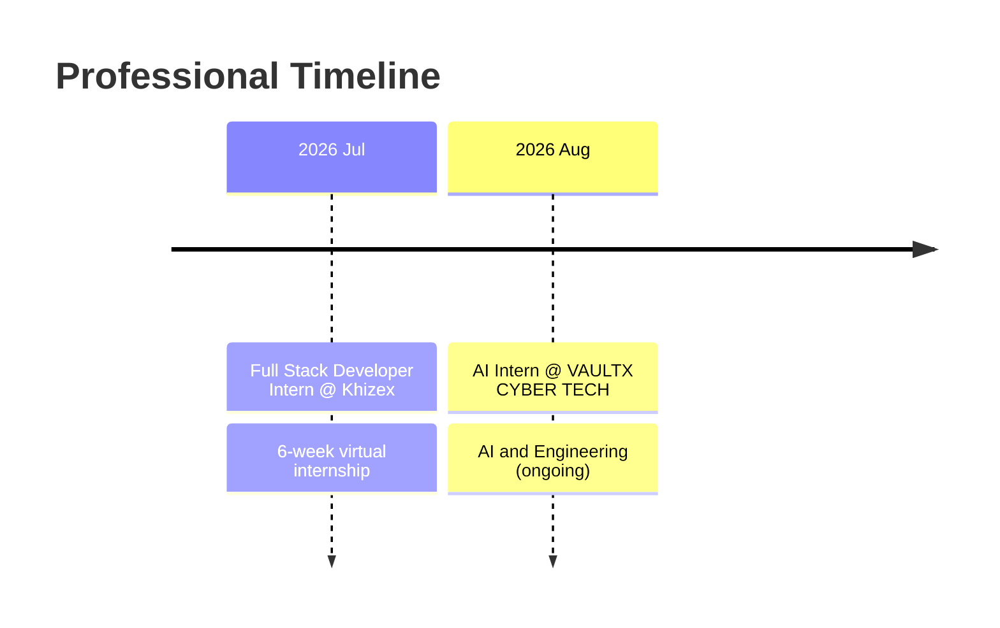

 

  

 

## 👩‍💻 About Me

I'm a **Computer Science student at Lahore College for Women University (LCWU)** and an **AI Intern at VAULTX CYBER TECH**. I build practical AI applications, explore Machine Learning and Deep Learning, and develop full-stack web projects.

<table>
<tr>
<td width="50%" valign="top">

### 🔭 What I'm Doing
- 🤖 Working as an **AI Intern** (remote)
- 🧠 Deepening my **ML / DL** fundamentals
- 💬 Exploring **NLP & Generative AI**
- 🌐 Building **full-stack** applications

</td>
<td width="50%" valign="top">

### 🎯 What I'm Aiming For
- 🚀 Shipping real-world AI products
- 🔐 Learning **responsible & secure AI**
- 🤝 Contributing to **open source**
- 📈 Growing as a software engineer

</td>
</tr>
</table>

> 💡 *Learn continuously. Build intelligently. Create meaningful impact.*

---

## 🧭 Journey

---

## 💼 Experience

<table>
<tr>
<td width="60%" valign="top">

### 🤖 Artificial Intelligence Intern
**VAULTX CYBER TECH Pvt Ltd** · Internship · Remote

- Working in **AI and Engineering**
- Contributing to AI-focused projects within the internship program

</td>
<td width="40%" valign="top">

📅 **Aug 2026 – Present**
📍 Lahore, Pakistan (Remote)

`AI` `Engineering`

</td>
</tr>
<tr>
<td width="60%" valign="top">

### 💻 Full Stack Developer Intern
**Khizex** · Internship · Remote

- Completed a 6-week virtual **Full Stack Development** internship
- Built hands-on skills in **Full-Stack Development and Software Design**

</td>
<td width="40%" valign="top">

📅 **Jul 2026 · 6 weeks**
📍 Lahore, Pakistan (Remote)

`Full Stack` `Software Design`

</td>
</tr>
</table>

---

## 🚀 Featured Projects

<table>
<tr>
<td width="33%" valign="top" align="center">

</td>
<td width="33%" valign="top" align="center">

</td>
<td width="33%" valign="top" align="center">

</td>
</tr>
</table>

<b>🎥 TubeBrief AI — YouTube Video Summarizer</b>

 

An AI-powered application that converts YouTube transcripts into concise, structured English summaries.

- Extract video transcripts or paste them manually
- Generate AI summaries with **Groq**
- Identify key points, topics, and takeaways
- Summarize supported non-English transcripts into English
- View transcript statistics and visualizations
- Download generated summaries

**Tech stack:** `Python` `Streamlit` `Groq API` `YouTube Transcript API`

<b>📊 Machine Learning Projects</b>

 

A collection of projects exploring Machine Learning concepts and their practical implementation.

- Supervised and unsupervised learning
- Predictive modeling and classification
- Model training and evaluation
- Data preprocessing and experimentation

**Tech stack:** `Python` `NumPy` `Pandas` `Matplotlib` `Scikit-learn`

<b>🧠 Deep Learning Projects</b>

 

A collection for exploring neural networks and Deep Learning techniques through practical projects.

- Neural network architectures
- Deep learning model training
- Data preparation and evaluation
- Experimentation and performance analysis

**Tech stack:** `Python` `TensorFlow` `Keras` `PyTorch`

---

## 🛠️ Tech Stack

| Category | Technologies |
|:--|:--|
| **Languages** |  |
| **AI / ML** |  |
| **Web** |   |
| **Tools** |   |
| **Focus Areas** | `Machine Learning` `Deep Learning` `NLP` `Generative AI` `Groq` |

---

## 📊 GitHub Analytics

 

  

  

<picture>
  <source media="(prefers-color-scheme: dark)" srcset="https://raw.githubusercontent.com/zaima-sohail/zaima-sohail/output/github-snake-dark.svg"/>
  <source media="(prefers-color-scheme: light)" srcset="https://raw.githubusercontent.com/zaima-sohail/zaima-sohail/output/github-snake.svg"/>
  
</picture>

---

## 📜 Certifications & Learning

<b>View all certifications</b>

 

| Certification | Issuer |
|:--|:--|
| AI Fluency Framework & Foundations | Anthropic |
| Introduction to Large Language Models | Google |
| Introduction to Security in AI Models | Google |
| AI Fundamentals | IBM |
| Azure AI Fundamentals | Microsoft |
| Introduction to Generative AI and Agents | Microsoft |
| Deploy and Evaluate Microsoft Foundry Models | Microsoft |
| Programming Essentials in Python | Cisco Networking Academy |
| Partnering with AI in the Workplace (Job Simulation) | Forage |

## 🏆 Honors & Activities

- 🌐 **Google Developer Program** — Google Cloud
- 💻 **Web Development Competition Hackathon Participant** — IEEE GCU Student Branch

---

## 🤝 Let's Connect

I'm open to internships, collaborations, and conversations about AI and software development.

  

⭐ *Thanks for visiting. Explore my projects and let's build something meaningful.*

